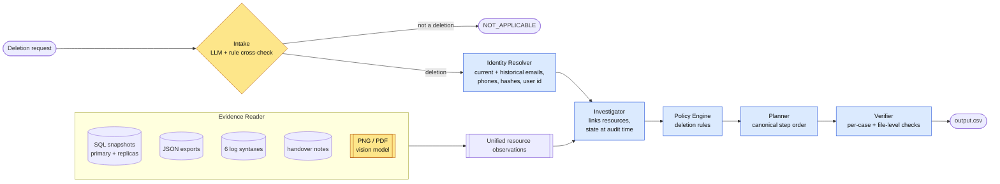
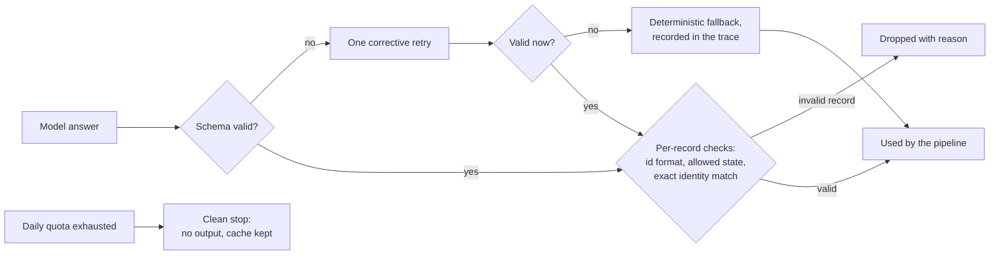
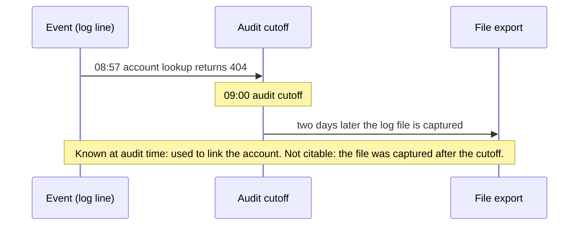

<div align="center">

# Ghost Data Still Exists

### A deletion-audit agent that checks whether a customer's personal data is really gone

[](https://nodejs.org)
[](code/package.json)
[](code/src/llm/groq.js)
[](code/src/llm/gemini.js)
[](code/docs/decisions.md)
[](https://claude.com/claude-code)

</div>

---

A company tells a customer their account has been deleted, and its internal dashboards agree. Weeks later
the customer's data is still in a read replica, a search index, a support attachment, an analytics export
and a backup, and a sync job has quietly recreated part of what was deleted. This agent investigates each
deletion request against the company's own records and evidence, decides whether the deletion is really
`COMPLETE`, `INCOMPLETE`, or not a deletion request at all, and writes an ordered plan of findings,
remediation and verification steps, citing the evidence behind every claim.

I designed it in 24 hours for HackerRank Orchestrate (October 2026, *Ghost Data Still Exists*) and
implemented it with [Claude Code](https://claude.com/claude-code) as my coding agent.

## Results

Official scoring, per component:

| Component | Score |
|---|---|
| Output CSV (graded against hidden answers for 518 requests) | 25.2 / 30 |
| Code zip | 16.8/30 |
| Chat transcript | 8.6/10 |
| AI judge interview | not completed |

My own evaluation, **on the 37 cases used for tuning** (32 labelled samples from the organizers and 5 cases I
wrote; optimistic by construction, see the [evaluation report](code/evaluation/evaluation_report.md)):

| Metric (on the 37 cases used for tuning) | Value |
|---|---|
| Case-level status accuracy | 37 / 37 |
| Step precision (every step produced matches an expected step) | 189 / 189 |
| Step recall | 189 / 217 (87.1%); every miss is a resource no evidence links to the person |
| Sequence accuracy | 37 / 37 |

On all 375 distinct requests of the full run, two different LLM families (`gpt-oss-120b` and `qwen3.8-27b`)
made the same intent decision every time.

## Design in one sentence

> **The model proposes, the code decides.** A deterministic workflow does everything that can be computed;
> LLMs are used only where the input is genuinely unstructured, and every model answer is validated before it
> can affect the result.

## Architecture



Yellow nodes involve a model; blue nodes are deterministic code. Every evidence format (normalized SQL, JSON
stored inside SQL replicas, snapshot bundles, service exports, six log syntaxes joined by trace id, text notes,
screenshots and PDFs) is reduced to one shape, `{file, time, system, resource, state, identifiers}`, and
everything after that is plain code.

### Where I used AI, and why only there

| Step | Approach | Why |
|---|---|---|
| Does the request actually ask for deletion? | **LLM** (`gpt-oss-120b`), with a rule classifier as independent cross-check and fallback | Requests arrive in many languages and with negations ("do not close the account"); keyword rules failed on an unseen language. |
| Screenshots and PDFs | **Vision** (`gemini-3.8-flash`), each extracted record validated | Some facts exist only in images, such as a support attachment. |
| Identity, time rules, policy, ordering, citations | **Code** | Deterministic, reproducible, and measurable field by field. |



## The subtle part: what was *known* vs what can be *cited*

Logs are often exported days after the events they contain. A line written at 08:57 for a 09:00 audit is
**knowledge** the auditor could have had, but the file it lives in did not exist yet, so it cannot be cited as
**evidence**. Separating the two was the core of the change that, together with one primary account per
person and broader intake rules, raised status accuracy on the tuning cases from 75% to 96.9%.



Other things the agent has to get right:
- **Replication drift**: a row deleted from the primary but still present in a read or failover replica is still personal data.
- **Claims vs evidence**: workflow statuses and reported results are claims; only evidence decides a resource's state.
- **Ghosts**: an active connector or a restorable backup that can recreate deleted data is a finding on its own,
  and remediation disables flows and blocks restores *before* deleting dependent records.
- **Retention**: security audit logs and legal holds must stay; account tombstones keep only a stable internal id.

## Evaluation-driven development

I measured every change against labelled cases (figures **on the 37 cases used for tuning**, the first two rows on the 32 samples only):

| Step | Status | Precision | Recall | What changed |
|---|---|---|---|---|
| Baseline | 75.0% | 99.2% | 65.8% | Rule-based intake, no vision |
| Time rules | 96.9% | 100% | 84.5% | Known vs citable, one primary account per person |
| LLM-first intake | 97.3% | 100% | 85.7% | A non-English deletion request is now understood |
| Vision on all files | 100% | 100% | 87.1% | A PDF attachment fixed the last wrong status |

I also measured and **rejected, with numbers**, a timing shortcut that turned out to be an artifact of how the
data was generated (it explained 104 of 248 actions), linking by elimination inside deletion batches (160 of
250 batches ambiguous), and an existence filter for vision records that would have discarded real evidence.
Details are in the [evaluation report](code/evaluation/evaluation_report.md) and the
[run history](code/evaluation/history.md).

## Engineering safeguards

- **File-level verifier**: re-reads the output from disk (header, row count, no duplicates, row order, valid JSON after the CSV round-trip); seven deliberately corrupted files are all rejected.
- **Prompt-injection guards**: request text and evidence are treated as data; injected instructions in the request, inside log evidence and inside a PDF do not change the decision.
- **Untrusted evidence**: SQL snapshots run in an in-memory SQLite with filesystem and extension statements rejected.
- **Determinism and provenance**: model answers are cached by model, settings, prompt and input; two builds are byte-identical; the usage report states which answers were fresh and which were reused, and when they were produced.
- **Cost honesty**: thinking tokens are counted (94% of vision output), and the cost of a run from an empty cache is reported next to the billed cost.

## Quick start

> **Running the evaluation requires the organizers' dataset (not included) and API keys.**

Requirements: **Node.js ≥ 22.13** (built-in `node:sqlite` and `fetch`). No npm dependencies.

```bash
cd code
npm install
# API keys in a git-ignored .env at the repository root:
#   GROQ_API_KEY=
#   GEMINI_API_KEY=
# place the challenge dataset in ./dataset (repository root)
npm run eval -- --custom          # evaluate on the labelled cases (needs the organizers' dataset)
npm run final                     # full run: ../output.csv + evaluation/usage_report.md
node src/verifyOutput.js ../output.csv
```

`npm run eval -- --custom` requires the organizers' dataset: it scores the labelled samples that ship with it, and the custom and injection cases I wrote on top of it are not included here.

Without keys the agent still runs: intent falls back to the rule classifier and visual evidence is reported as
unread instead of being guessed.

## Repository layout

```
code/
  main.js                 entry point
  src/agent.js            role pipeline for one case
  src/ingest/             Evidence Reader: sql, json, logs, text, visual + shared record mapper
  src/identity.js         Identity Resolver
  src/investigate.js      Investigator (linking, time rules)
  src/policy.js           Policy Engine
  src/planner.js          Planner (canonical ordering)
  src/verifier.js         per-case invariants  ·  src/verifyOutput.js  file-level contract
  src/intake.js           LLM intake + rule cross-check + injection signals
  src/llm/                provider adapters (groq, gemini, fake), cache, retries, usage
  prompts/                model prompts (Markdown)
  evaluation/             evaluation harness, reports and run history
  docs/decisions.md       31 architecture decision records
```

## Known limitations

- **Unlinkable resources** cost recall: some accounts and fully anonymized analytics records have no identifier
  connecting them to the person in the supplied evidence, and the agent refuses to guess.
- My own metrics come from the cases I tuned on; the external measure is 25.2/30 on the Output CSV component.
- There is no automated unit-test suite yet: behaviour is locked by the evaluation harness, byte-identical
  rebuilds and fault-injection checks.

## How I built it

I directed the design and approved every decision; [Claude Code](https://claude.com/claude-code)
implemented it under my direction. Each choice, the alternatives I rejected, and the incidents along the way
are recorded in [`code/docs/decisions.md`](code/docs/decisions.md).

## License

My code in this repository is released under the [MIT License](LICENSE). The challenge, its problem statement and its dataset belong to HackerRank; they are not included here and are not covered by this license.
